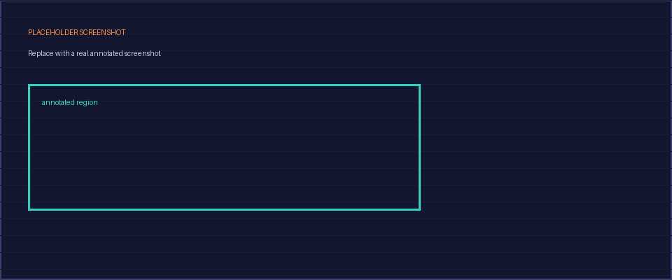

## Context
PLACEHOLDER. A `writeup` is a walkthrough or explainer, you teaching the reader something you did or figured out. Delete this and write real content.

## Approach
PLACEHOLDER.

## Evidence
PLACEHOLDER: evidence examples, replace both.

## Takeaway
PLACEHOLDER.
